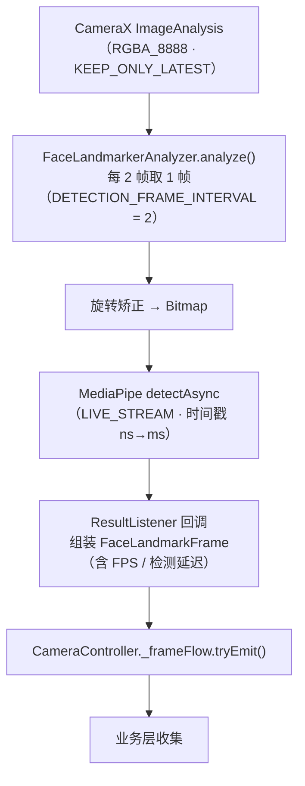

# core:camera

> 前置摄像头采集 + MediaPipe FaceLandmarker 逐帧关键点分析的基础能力模块（无预览、供后台使用）。

## 职责

- 绑定前置相机（CameraX，无预览、仅 `ImageAnalysis`），把逐帧分析结果以 `SharedFlow` 对外暴露
- 基于 MediaPipe FaceLandmarker（478 点）提取疲劳检测所需指标：人脸框、双眼 EAR 6 点、虹膜 5 点 + 虹膜直径、FPS/延迟
- 从 Camera2 特性读取前置相机焦距，供 Depth-from-Iris 测距

## 对外 API

| 类型 | 说明 |
|---|---|
| `CameraController` | 无预览分析控制器（`@Singleton`）：`start(lifecycleOwner, onError)` / `stop()` / `frameFlow: SharedFlow<FaceLandmarkFrame>` / `isRunning` |
| `CameraIntrinsicsProvider` | 读取前置相机焦距：`focalLengthPx(analysisWidth): Float`（失败返回 0） |
| `FaceLandmarkerAnalyzer` | `ImageAnalysis.Analyzer` 实现，由 `CameraController` 内部创建，业务层不直接接触 |

## 数据流



## 共享 FaceLandmarker 设计

`FaceLandmarker` 实例初始化开销大（加载 478 点模型），且 `LIVE_STREAM` 模式下回调经全局回调列表分发，因此所有 Analyzer 实例共享一个 FaceLandmarker 单例；Analyzer 的 `close()` 只注销自己的回调，不销毁引擎（引擎生命周期 = 进程）。

```classDiagram
class FaceLandmarkerAnalyzer {
    -FaceLandmarker faceLandmarker
    -(FaceLandmarkerResult)->Unit resultHandler
    -PendingFrame pendingFrame
    +analyze(ImageProxy)
    +handleResult(FaceLandmarkerResult)
    +close()
}

class SharedFaceLandmarker {
    -FaceLandmarker instance$
    +get(Context) FaceLandmarker$
}

class handlers {
    <<companion>>
    -CopyOnWriteArrayList~回调~ handlers$
    +add()
    +remove()
    +forEach()
}

class FaceLandmarker {
    <<单例>>
    +detectAsync()
    +createFromOptions()
}

FaceLandmarkerAnalyzer --> SharedFaceLandmarker : 获取
FaceLandmarkerAnalyzer --> handlers : 注册/移除回调
SharedFaceLandmarker --> FaceLandmarker : 持有
handlers --> FaceLandmarkerAnalyzer : 回调执行（通过 resultHandler）
```

```sequenceDiagram
participant A as Analyzer A
participant H as handlers 全局列表
participant FL as FaceLandmarker<br>(单例)
participant MediaPipe as MediaPipe<br>引擎

Note over A,MediaPipe: 1️⃣ 初始化阶段

A->>H: init { handlers.add(resultHandler) }
Note over H: 列表现在包含: [A的回调]
A->>FL: get(context)
FL-->>A: 返回共享实例

Note over A,MediaPipe: 2️⃣ 正常运行阶段（每帧循环）

loop 每一帧
    A->>A: analyze(imageProxy)
    A->>MediaPipe: detectAsync(mpImage, timestamp)
    MediaPipe-->>FL: 检测完成，触发 ResultListener
    FL->>H: handlers.forEach { it(result) }
    H->>A: 调用 A 的 resultHandler
    A->>A: handleResult(result)
end

Note over A,MediaPipe: 3️⃣ 清理阶段

A->>H: close() { handlers.remove(resultHandler) }
Note over H: 列表现在为空
```

## 依赖关系

- **依赖**：`core:model`（FaceLandmarkFrame 等）；CameraX、MediaPipe tasks-vision
- **被依赖**：`feature:fatigue`（FatigueMonitor）、`feature:services`（检测页）、`app`（Hilt 可见性）
- 模型资产：`src/main/assets/face_landmarker.task` 随本模块打包

## 注意事项

- 时间戳：CameraX 给纳秒，`detectAsync` 期望毫秒，代码里做 `/1_000_000` 换算
- `ImageAnalysis` 使用 `STRATEGY_KEEP_ONLY_LATEST`：旧帧未处理完直接丢弃，分析不阻塞相机
- `toArgbBitmap` 会处理 `rowStride ≠ pixelStride × width` 的行填充；旋转在送入 MediaPipe 前完成
- `CameraIntrinsicsProvider` 假设分析图为传感器全视野等比缩放，若 CameraX 裁切会引入近似误差
- tasks-vision 预编译 `.so` 仅 `arm64-v8a`，模块需保持 `abiFilters` 一致
