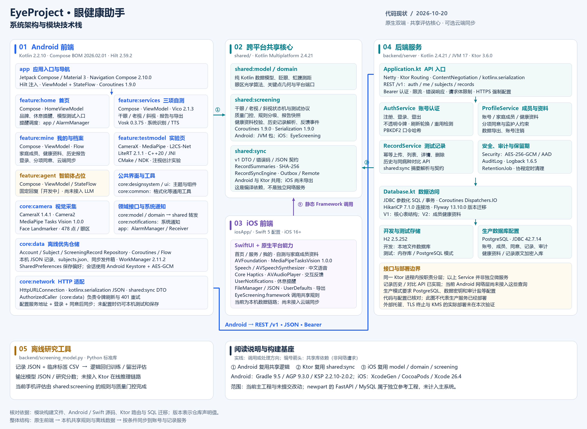

# EyeProject 系统架构与模块技术栈

核对日期：2026-10-20。范围为当前工作区主工程，包含当日未提交的功能改动。技术版本取自项目声明，不表示本次执行了构建、运行或生产部署验证。

- `EyeProject-architecture.png`：3000 × 2190 高清架构图，适合插入报告和演示文稿。
- `EyeProject-architecture.svg`：可缩放、可编辑文字的矢量版。
- `preview.png`：预览图。
- `render_architecture.py`：重绘源文件，同时生成 PNG 和 SVG，并检查文字是否超出卡片。

## 关键结论

1. 前端为原生 Android 与原生 iOS。Android 使用 Kotlin、Jetpack Compose、Hilt、ViewModel 和 StateFlow；iOS 使用 SwiftUI 与苹果平台能力。主工程不存在独立 Web 前端。
2. `shared/model`、`shared/domain`、`shared/screening` 是双端共用的 Kotlin Multiplatform 核心；测试状态机、质量门控、风险规则与报告在本机运行。Android 通过 JVM 依赖使用，iOS 通过 `EyeScreening.framework` 使用。
3. Android 的记录和成员资料先在本机保存，再按服务器配置、登录、同意状态同步。`core:network` 使用 `HttpURLConnection`，`core:data` 使用 WorkManager 调度同步。
4. 后端是单一 Ktor / Netty 服务，按认证、成员资料、记录、安全审计与数据访问分层。图中的各 Service 为进程内模块，不是独立微服务。
5. 开发默认使用 H2 文件库，接口测试使用 H2 内存库；生产配置要求 PostgreSQL。健康资料和记录原文使用 AES-GCM 加密入库。
6. `shared/sync` 的 DTO、摘要与同步逻辑由 Android 和后端共用，目前未导出到 iOS Framework。iOS 尚未接入主后端的账号与云端同步。
7. `feature/agent` 是对话界面占位，发送后固定回复“开发中”。`backend/screening_model.py` 是离线研究脚本，未连接到 Ktor 在线推理或手机自动模型下发。
8. `newpart/` 中的 FastAPI / MySQL 与另一套 Android 工程属于独立参考代码，未纳入根项目的模块清单，故未画成主系统能力。

## 核对入口

| 内容 | 仓库文件 |
|---|---|
| Android 模块清单与版本 | `settings.gradle.kts`、`gradle/libs.versions.toml`、`app/build.gradle.kts` |
| 各业务模块及平台库 | `feature/*/build.gradle.kts`、`core/*/build.gradle.kts` |
| 应用路由与休息提醒 | `app/src/main/java/com/zkyjss/eyeproject/ui/EyeProjectNavHost.kt`、同包下 `reminder/` |
| 智能体占位 | `feature/agent/src/main/java/com/zkyjss/eyeproject/feature/agent/AgentViewModel.kt` |
| 网络与离线保存 | `core/network/src/main/java/com/zkyjss/eyeproject/core/network/HttpEyeNetworkDataSource.kt`、`core/data/DATA.md`、`core/data/src/main/java/com/zkyjss/eyeproject/core/data/` |
| 共享核心及 iOS 导出 | `shared/SHARED.md`、`shared/build.gradle.kts`、`shared/screening/build.gradle.kts`、`shared/sync/build.gradle.kts` |
| iOS 界面与平台实现 | `iosApp/Sources/`、`iosApp/Podfile`、`iosApp/project.yml` |
| 服务端依赖与边界 | `backend/server/build.gradle.kts`、`backend/server/SERVER.md` |
| 路由、服务、认证与数据库 | `backend/server/src/main/kotlin/com/zkyjss/eyeproject/server/` |
| 数据表与迁移 | `backend/server/src/main/resources/db/migration/` |
| 离线研究工具 | `backend/screening_model.py`、`backend/README.md` |
| 独立参考代码的范围 | `docs/newpart代码对比与整合建议-2026-10-20.md`、根 `settings.gradle.kts` |

根目录 `README.md` 仍有旧的疲劳监测模块、旧版本和旧 UI 依赖说明；本图以当前构建配置、路由和源码为准。
