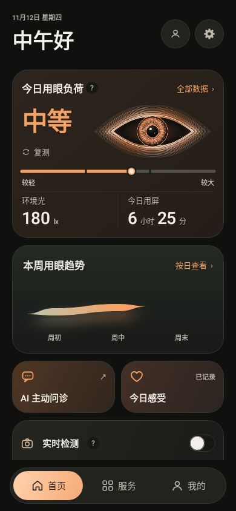
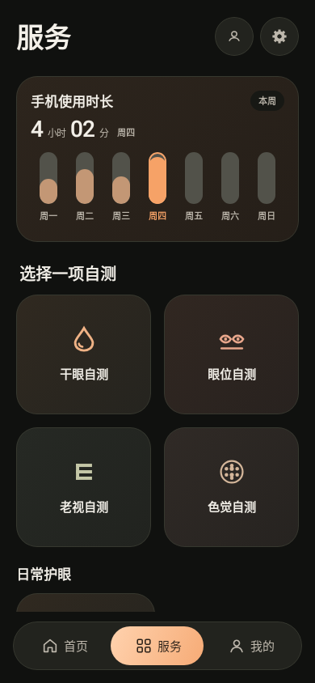
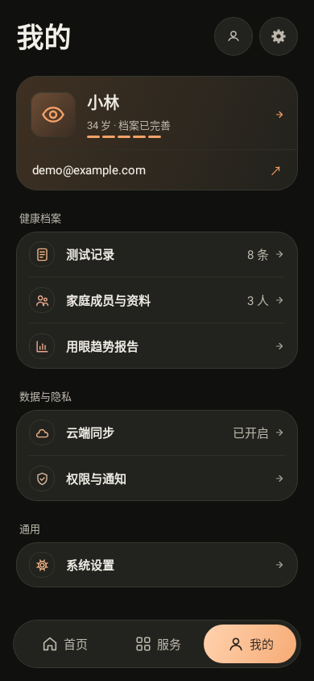

# 棕色深色界面预览

本分支从 `codex/self-cover-guides-20261111` 的 `1a97c21` 创建，分支名 `codex/brown-dark-ui-20261112`。该提交保存原蓝色距离提示与图标配色改动。

以下由真实 Android Compose / Robolectric 图形管线输出，尺寸 390 × 844，含正式底部导航组件。页面使用测试中的示例账号与用屏数据，不是实际检测结果。未来日期和无历史数据不补造读数。

| 首页 | 服务 | 我的 |
|---|---|---|
|  |  |  |

设计依据与呈现边界见根目录 `DESIGN.md`。眼睛来自提供的参考稿 SVG，双方素材在 `shared/artwork/`。

验证：Android Kotlin 编译、Debug APK、lint 与 home / services / mine 共 133 项测试通过，覆盖空态、小屏大字号、横屏、导航、感受记录、实时检测和自测流程。iOS 双端令牌与资源静态检查通过；Windows 未执行 Xcode 编译和真机测试。

APK：当前工作区 `app/build/outputs/apk/debug/app-debug.apk`。
