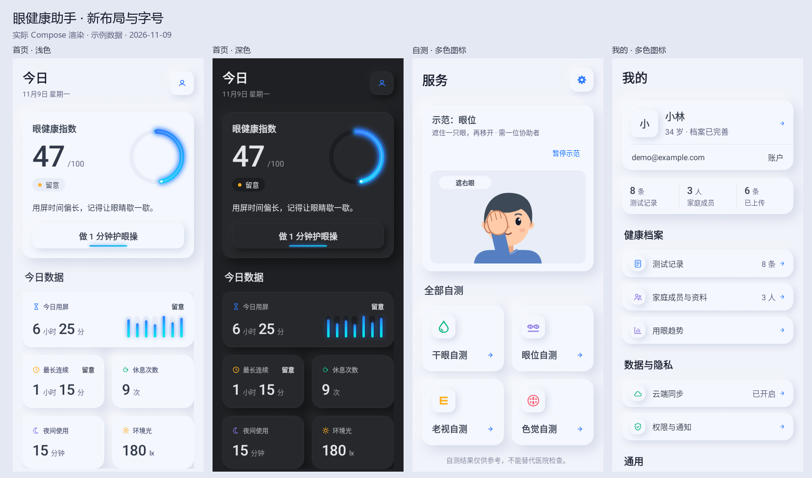

# Soft Health UI 改版

分支：`codex/soft-health-ui`。材质依据：根目录 `DESIGN.md`；布局、图标配色和字阶按用户 2026-11-09 的反馈调整。

## 本次调整

- 首页主卡改为左分数 / 右圆环，分母与分数同基线，状态标签在下，建议左对齐；保留护眼操按钮与原有评分规则。
- 主分数 60、页面标题 26、分区标题 20、卡片标题 18、读数 30、正文 16、辅助和单位 14；窄屏大字号下自动采用紧凑分数。
- 图标按功能使用蓝 / 绿 / 橙 / 紫 / 玫红；图表继续使用蓝青渐变，中性文字保持清晰。
- 圆环和数据光条增加更明显的蓝色柔光外晕与亮芯，深色模式下提高光晕强度；图标与文字不额外发光。
- 修复字体放大后小屏测试页下方方向键被挤出可见区：大字号作答键由 68 调整为 56，窄屏隐藏装饰性距离小标尺以完整显示移动提示，保持触摸面积与视标物理尺寸；回归测试等待布局动画稳定后检查。

[首页明暗对照](home-layout-preview.png) · [小屏大字号首页](home-large-text.png) · [小屏测试作答](session-small-large-text.png)

## 实际界面预览

以下均由现有 Compose 页面在 Robolectric 原生图形模式下渲染，数据为测试样例；不含 app 外层导航栏和系统栏，不代表真实测量结果。

| 页面 | 预览 |
|---|---|
| 首页 | [浅色](home-light.png) · [深色](home-dark.png) |
| 自测入口 | [普通字号](services-light.png) · [320dp / 1.5 倍字号](services-large-text.png) · [横屏](services-landscape.png) |
| 我的 / 账户 / 记录 | [我的](mine-light.png) · [账户](account-light.png) · [记录](records-light.png) |
| 趋势 | [深色数据图表](trend-dark.png) |
| 测试流程 | [准备与测距](dry-eye-setup.png) · [大字号引导](guide-large-text.png) · [结果](dry-eye-report.png) |

## 改动范围

- 双端主题统一为低饱和蓝灰背景、同色浮雕卡片与双向柔和阴影；深色主题使用极淡边缘线。
- 全局更新按钮、返回与账户图标、列表、表单、选择控件、数据图表、字号与留白；共享组件覆盖测试准备、问卷、测距、报告、档案、同步、权限、AI 页面与实验入口。
- 首页采用左侧大分数与右侧紧凑圆环；读数卡与工具卡沿用真实数据与原有点击事件。
- 四项自测保持原有回调与顺序，普通字号双列、窄屏大字号单列；示范支持暂停、继续、点击切换和系统减少动画设置。
- 保留三个顶层导航目的地，选中实心图标、未选线稿；底栏保留系统安全区。
- iOS 主题、主页面和共享控件同步调整；保留系统导航和已有平台功能差异。
- 业务引擎、仓储、记录格式、云端协议、权限流程、相机管线和模型没有改动；视标、色觉刺激与临床测试流程维持原实现。

## 验证记录

- `:app:compileDebugKotlin`：通过。
- `assembleDebug`：通过，APK 位于 `app/build/outputs/apk/debug/app-debug.apk`。
- `:feature:home:testDebugUnitTest :feature:mine:testDebugUnitTest :feature:services:testDebugUnitTest`：18 个测试套件、122 项测试，0 失败、0 错误。
- 新增回归覆盖：首页深色数据、小屏大字号工具入口、四项自测在小屏大字号与横屏下的可达性和点击事件。
- `:app:lintDebug`：通过，0 错误、33 条警告；报告位于 `app/build/reports/lint-results-debug.html`。
- `python scripts/ios/check_project.py`：通过，覆盖双端令牌、模型哈希、SDK、共享代码平台边界与代理说明一致性。
- 27 个 iOS Swift 源文件的 tree-sitter 语法检查：通过。此检查不能替代 Swift 类型检查、Xcode 编译或真机测试。
- 已检查浅色、深色、无数据、375dp / 1.5 倍字号首页、320dp / 1.5 倍字号服务页、横屏服务页、测试准备、结果、档案与账户等截图。

## 待真机验收

本轮未安装到手机，未进行相机、麦克风、语音、通知的真机回归。Windows 无法运行 Xcode；iOS 仍需在 macOS 编译并验证真实设备、动态字体及 VoiceOver。Android TalkBack、外接键盘焦点和更极端字号也需真机补验。
