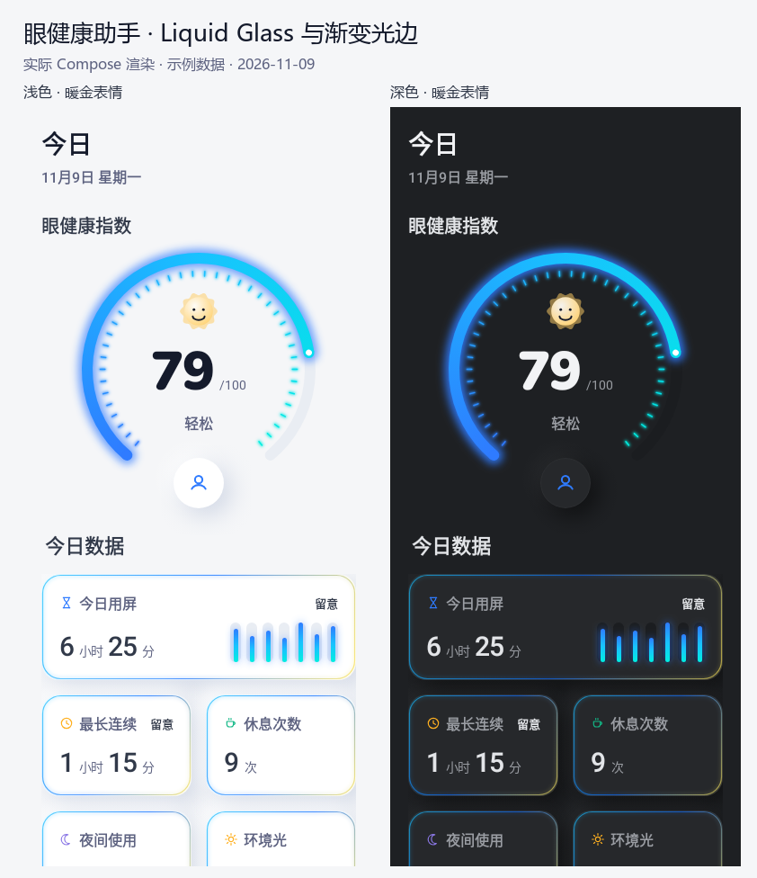
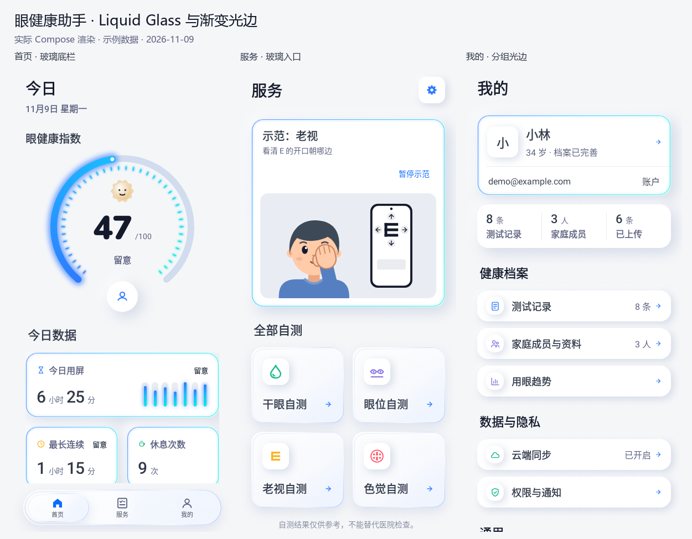
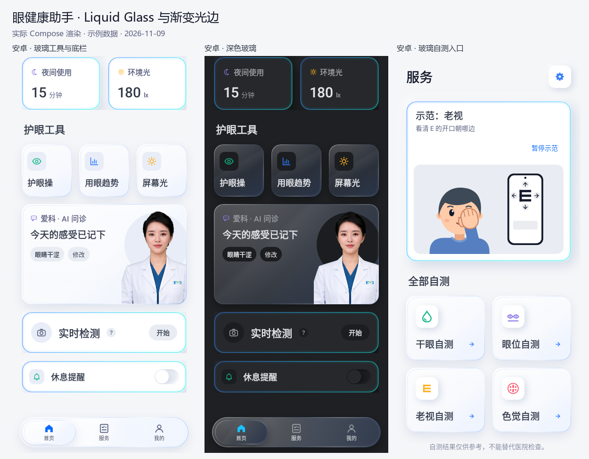
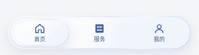

# Soft Health UI · 当前改版

分支：`codex/soft-health-ui`。当前以用户 2026-11-09 的最新反馈为准，保留 DESIGN.md 的柔和材质与蓝青数据语言。

## 仪表与首页

首页取消仪表底色块、重复的护眼操按钮与提醒文字。护眼操仍可从「护眼工具」进入。
仪表从左下沿上方充能到右下，底部保留开口放账户头像；默认头像使用账户首字母或人像，可点开账户。
环内等长短刻度按圆环位置取蓝青渐变色并发光；保留暖金 / 浅金 / 银色矢量表情与 Nunito Black 粗体分数。表情映射已有评估等级，不参与评分。
修复起点异色圆帽，取消圆环白色内线；光晕仍限定在数据图形。

[暖金 79 分](gauge-gold-79.png) · [银色 20 分](gauge-silver-20.png) · [完整首页](home-full.png) · [小屏大字号](home-large-text.png)

首页、服务和我的页统一放大标题：页标题 28、分区 22、卡片 20；灰色类别标题 16 号半粗，列表标题 18 号半粗。

## 卡片渐变光边试版

今日数据、方法示范、个人卡和概览采用整圈蓝、青到青绿色的渐变光边；列表与开关行采用较淡版本。边线 1.2、窄光晕 3，不改变布局和操作范围。仪表仍无底色块，原版演示人物与动作保持。

## Liquid Glass 试版

- 安卓护眼工具、爱科入口、自测入口和底部导航采用轻量玻璃视觉模拟：半透明层次、弧形高光、双层镜片边缘与轻微环境染色。没有实时背景采样、模糊或折射，不依赖额外图形库。
- 底栏保留三个导航入口与选中语义，选中镜片平滑滑动；移除动画时直接定位。
- iOS 26+ 使用原生 `.glassEffect(.regular.interactive(), in:)`；早期系统使用 `.ultraThinMaterial` 与镜片高光。减少透明度时回退为实体面板。
- 数据卡、列表和方法示范保留渐变光边，仪表保持无底色块；原版演示人物与动作保持。

参考：[Apple Liquid Glass](https://developer.apple.com/design/human-interface-guidelines/materials)、[Android 图形与缓存](https://developer.android.com/develop/ui/compose/graphics/draw/modifiers)。

## 最新简化

问诊页使用 104 的介绍头像和 48 的消息头像，介绍左对齐并放大至 18；消息头像与气泡顶部对齐。移除操作提示、总结小标签、历史选项回显、消息参考小字及底部说明。首页工具去掉说明小字，「亮度与蓝光」入口改名「屏幕光」，保持单行。我的页只保留顶部个人卡的渐变边框。
iOS 圆环扩大滤镜画布，抵消布局尺寸，保持环体、刻度与中心内容的位置和大小；新增上下左右外晕像素测试，由本次 macOS 云端验证。

## 对话与操作

- 用户消息改为主蓝色的高对比变体 `#0A6CFF`，配白字；与白字对比度约 4.56:1。
- 双方消息正文改为 18 号字，Android 行高 28；iOS 增加消息行距。
- 主要与次要操作按钮用整圈渐变光条边框，取消短底线；危险操作保留语义提示。
- 删除首页实时检测的「眨眼与距离…」说明，标题增至 22，帮助、开始 / 停止和检测数据保留。
- 浅色页面背景 `#F5F6F8`、内容表面白色、主按钮浅蓝底，提高区域区分。

[AI 对话](chat-light.png) · [其他界面总览](overview.png)

## 人物与动画

按反馈还原原版平面人物、豆豆眼、纯色上衣与手掌描边。
恢复原版动作曲线、三角脉冲及关键帧；眼位、遮眼锚点、演示步骤与循环时长保持原样。
减少动态效果和暂停 / 继续功能仍保留；动画仅出现在方法演示，不参与真实测量或计时。

[人物帧对照](guide-character-preview.png) · [准备与测距](dry-eye-setup.png) · [大字号引导](guide-large-text.png)

## iOS 圆环修复

首帧直接读取当前分数，后续由 Animatable 层插值；取消默认零值与 onAppear 初始化依赖。无数据时保留更清晰的蓝灰空轨道，不伪造分数与进度。ProgressRingRenderingTests 覆盖首帧弧线、明暗主题、禁用动画事务、无数据与零值，实际执行结果以本次 macOS 云端测试为准。

## 验证

- Android compileDebugKotlin、assembleDebug、125 项测试：通过。
- lintDebug：0 错误、33 条警告。
- 双端令牌、模型、字体资源与授权、工程结构检查：通过。
- iOS Swift 语法检查：通过；尚未在 macOS 对本次改动进行 Xcode 编译和真机验收。
- 预览由原生 Compose 图形测试生成，使用虚构示例数据，不含系统栏；玻璃预览包含与 app 同一组件的底栏，其他截图不含 app 外层导航栏；动画 GIF 为同一渲染器的 48 帧完整周期。

APK：`app/build/outputs/apk/debug/app-debug.apk`。
字体来源与授权详见 `core/designsystem/FONTS.md`。
