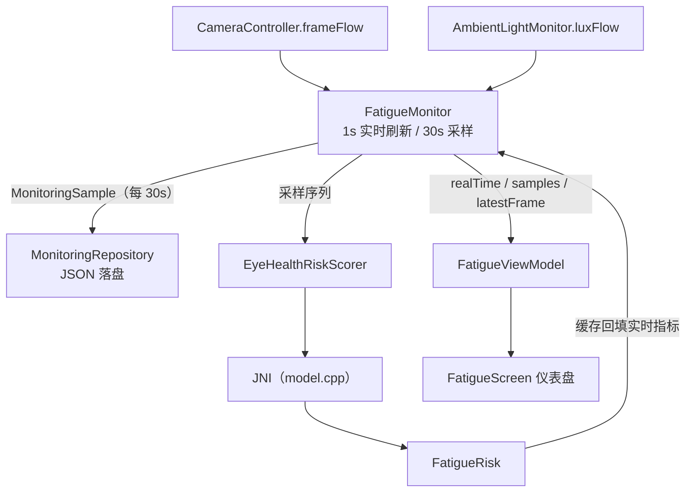

# feature:fatigue

> 核心业务模块：实时眼疲劳监测引擎 + C++ 风险评分算法（JNI）+ 仪表盘 UI。

## 职责

- 驱动「相机 → 检测 → 指标 → 评分 → 持久化」的主数据流（引擎由 app 层前台服务持有，后台持续运行）
- 封装 C++ 疲劳评分算法的 JNI 桥与领域映射
- 仪表盘：实时指标、历史曲线、风险仪表、色温/提醒控制

## 分层结构

### 引擎层

| 类型 | 说明 |
|---|---|
| `FatigueMonitor` | 监测引擎（`@Singleton`，被 `MonitoringService` 持有）。`start(lifecycleOwner)` 后并发跑 4 个协程任务：帧收集（EAR→眨眼、虹膜→距离）、光照收集、**每 1 秒**实时指标刷新、**每 30 秒**采样落盘。`stop()` 时 `repository.flush()`。风险打分带缓存：采样序列（30s）不变就不重复走 JNI |

### 算法层（C++ via JNI）

| 类型 | 说明 |
|---|---|
| `EyeHealthNative` | JNI 桥（`libeye_health_jni.so`）：`computeRiskSeries`（数值）/`computeRiskSeriesText`（文案），输入为 6 条等长时间序列 + 画像 `double[7]`；支持运行时切换组合层 `setCombinerLogistic` / `resetCombiner` |
| `EyeHealthRiskScorer` | 门面（`@Singleton`）：`List<MonitoringSample>` + `UserProfile` → `FatigueRisk`，屏蔽数组拼装 |
| `UserProfile` | 静态画像 7 字段（age/近视/干眼/遗传/姿势/不适/对比度），当前默认值，与 JNI `profile double[7]` 顺序严格一致 |
| `cpp/` | `model.cpp`（评分算法）+ `eye_health_jni.cpp`（JNI）；CMake FetchContent 拉 abseil/flatbuffers/OpenCL |

### 领域映射

| 类型 | 说明 |
|---|---|
| `FatigueRisk` | 评分结果：totalRisk/level/advice + 6 因子（light/distance/time/blink/personal/feedback）+ 派生指标 + 10 维特征向量；`fromOutput` 是 JNI 输出布局的**权威文档** |
| `FactorScore` / `RiskMetrics` | 单因子结果 / 派生指标 |

### UI 层

| 类型 | 说明 |
|---|---|
| `FatigueScreen` | 仪表盘（自绘 + vico 曲线），含相机/通知/悬浮窗/精确闹钟权限流程 |
| `FatigueViewModel` | 单向数据流：`uiState: StateFlow<FatigueUiState>` + `permissionEvents: SharedFlow`（权限请求一次性事件） |
| `FatigueUiState` / `FatiguePermissionEvent` | UI 状态 / 待 Activity 处理的权限事件 |
| `RiskGauge` / `EyeLineChart` | 自绘风险仪表 / 历史曲线（vico） |
| `MonitoringServiceLauncher` | 接口：启停后台监测服务，实现在 app 层（feature 不能反向依赖 app） |
| `navigation/FatigueNavigation` | `FatigueRoute` + `navigateToFatigue()` + `NavGraphBuilder.fatigueScreen(onNavigateToTestModel)` |

## 数据流

## 依赖关系

- **依赖**：`core:camera`、`core:data`、`core:domain`、`core:model`、`core:common`、`core:designsystem`、`core:ui`
- **被依赖**：`app`（MonitoringService 持有 FatigueMonitor；NavHost 挂 fatigueScreen）
- C++：NDK 27.3 + CMake；`abiFilters arm64-v8a`

## 注意事项

- `EyeHealthNative` kdoc 写的 `double[29]/String[9]` 与 `FatigueRisk.fromOutput` 的 `double[27]/String[8]` 布局描述不一致，以后者为准（改 C++ 输出布局时两处都要同步）
- `BlinkDetector.reset()` 在每条样本写入后调用，保证样本记录的是「本采样区间」眨眼数
- 未检测到人脸时距离/眨眼置 0 且跳过打分（实时指标显示「未检测到人脸」）
- `lifecycleOwner` 传的是前台服务（`LifecycleService`），这是相机能在后台持续运行的关键
