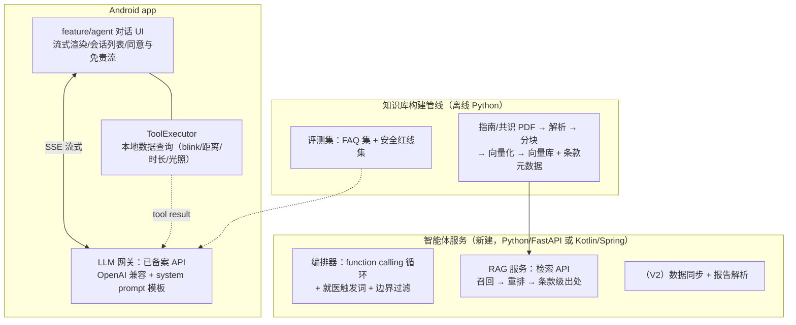

# 眼科智能体实施方案（MVP → V4）

- 日期：2026-09-11 | 前置调研：[eye-agent-tech-research.md](eye-agent-tech-research.md)（技术路线与合规红线）
- 目标：把调研结论转成 EyeProject 可开工的工程计划。本文只做 **MVP（需求③+①的子集）** 的详细设计，V2+ 给出方向。

---

## 0. 三个先决设计决策

| 决策 | 选择 | 理由 |
|---|---|---|
| **检测数据在哪分析** | **留在手机端**：服务端只下发「工具调用指令」，app 本地查询聚合后回传结果摘要 | 合规最轻（敏感数据不出端，PIPL 压力最小）；app 现有数据本就在本地；符合 PHIA「预聚合摘要注入」模式 |
| **对话生成在哪** | 云端已备案 LLM API（OpenAI 兼容协议），服务端做网关与编排 | 端侧小模型中文问答质量不胜任（调研结论）；自部署可后置到微调完成后无缝切换 |
| **MVP 范围** | 用户智能体：眼科科普问答（RAG+溯源）+ 我的数据解读 + 就医引导。**不做**：报告拍照解读（V2）、医生智能体（V4）、端侧 LLM（不做） | 最小闭环验证价值；措辞合规（健康参考/趋势解读，不输出诊断） |

---

## 1. 系统架构与模块划分



### Android 侧（复用现有模块结构）

| 模块 | 新增内容 | 说明 |
|---|---|---|
| `feature/agent`（现为占位页） | 对话 UI：会话列表、消息流（Markdown 渲染 + 引用角标）、流式输入框；首次进入的**单独同意弹窗** + 免责声明页 | 走 `/new-screen` 既有导航三件套 |
| `core/agent`（新，或并入 feature） | `AgentApi`（SSE 流式客户端）、`ToolExecutor` 接口、`AgentConversationStore`（会话本地持久化） | 网络层复用 app 现有 OkHttp/Retrofit |
| `core/data`（既有） | 增加检测数据**聚合查询接口**：`BlinkStats(day)`、`DistanceStats(day)`、`ScreenTimeStats(day)` → 返回预聚合结构 | ToolExecutor 的数据源；现有 CSV/JSON 落盘格式是前置输入 |

### 服务侧（新建仓库）

| 组件 | 职责 | 技术栈维度 |
|---|---|---|
| `gateway` | 已备案 LLM API 代理（流式、重试、审计日志、敏感词/诊断边界过滤） | OpenAI 兼容协议；模型选型维度见调研 §3.1 |
| `orchestrator` | function calling 循环：LLM 发起 `query_eye_data{metric,range}` → 指令下发 app → 结果回填 → 继续生成；就医触发词命中 → 强制追加就医提示 | 轻量自研循环（不上重框架） |
| `rag` | 检索 API：top-k 召回 → 重排 → 返回条款文本+出处；生成侧强制「无检索结果时回答未收录」 | 向量库/重排器按调研 §4 维度选型 |
| `kb-builder`（离线） | 指南 PDF → 解析 → 条款级分块 → 向量化 → 入库；评测集构建 | Python 脚本，一次性 + 增量 |

**工具定义（MVP 只有一个，刻意从简）**：

```json
{ "name": "query_eye_data",
  "description": "查询用户本机眼健康检测数据的统计摘要",
  "parameters": { "metric": "blink_count|distance|screen_time|light",
                  "range": "last_7d|last_30d" } }
```
app 端 ToolExecutor 返回：`{ "summary": "近7天日均眨眼 23 次，工作时段集中…", "anomalies": [...] }`——**摘要由端侧聚合生成，原始明细不出端**。

---

## 2. Prompt 与边界设计（合规核心）

1. **System prompt 骨架**：角色（眼健康助手）→ 能力边界（提供健康参考与趋势解读，不构成诊断）→ 输出要求（引用知识库时标注条款出处）→ 触发词处理规则
2. **就医触发词表**（命中即强制追加就医提示，且该轮不引用检测数据下结论）：
   - 眼压类：恶心呕吐 + 视力下降 + 眼胀头痛（急性闭角型青光眼疑似）
   - 急症类：视力骤降/视野缺损/眼外伤/化学入眼
   - 儿童类：低龄儿童视力异常
3. **固定免责文案**：首次使用同意页 + 每次回答尾部「以上为健康参考，不构成医疗建议」
4. **边界过滤**：网关侧检测回答中是否出现「诊断为/患有 XX 病/建议服用」等模式 → 拦截改写

---

## 3. 知识库构建（MVP 语料清单）

| 语料 | 来源状态 | 优先级 |
|---|---|---|
| 近视防治指南（2024 版） | 卫健委 PDF 已有直链 | P0 |
| 中国干眼临床诊疗专家共识（2024） | 中华眼科杂志 | P0 |
| 青光眼/结膜炎科普基础 2-3 份 | 需收集 | P1 |
| 评测集：50-100 条 FAQ + 20 条安全边界题 | 自建 | P0（与知识库同步建） |

分块策略：按**条款/小节**切（保留「3.2.1」类编号作为溯源锚点）；入库时记录文档名+条款号，生成时以「（来源：近视防治指南 2024 §3.2）」格式引用。

---

## 4. 任务分解与里程碑

| 里程碑 | 任务 | 估时 | 交付判据 |
|---|---|---|---|
| **M1 对话跑通**（1-1.5 周） | LLM API 接入 + 网关（流式/审计/边界过滤雏形）；feature/agent 对话 UI；同意与免责流 | — | 手机上可与助手流式对话 |
| **M2 RAG 眼科问答**（2-3 周） | kb-builder 管线 + 3-5 份指南入库；rag 检索 API + 引用格式；评测集 50+ 条 | — | 眼科 FAQ 回答带条款引用；评测集通过率 ≥ 目标 |
| **M3 数据解读**（2 周） | core/data 聚合查询接口；ToolExecutor + 编排工具循环；预聚合摘要格式 | — | 「我最近眨眼正常吗」类问题能基于真实数据回答 |
| **M4 合规收尾**（1 周） | 红队测试（诱导诊断/越界话术）；边界过滤完善；文案法务过审；合规自查表 | — | 上线检查单全绿 |
| **V2 方向**（后置） | 报告拍照解读（OCR→结构化确认→注入）；医生智能体；OCEC 微调数据采集 | — | — |

---

## 5. 关键风险与对策

| 风险 | 对策 |
|---|---|
| 云端 API 的模型服务变更/停服 | 网关抽象 OpenAI 兼容协议，可切换；自部署 SGLang/vLLM 作为 Plan B（调研 §7） |
| 幻觉输出被用户当诊断 | 溯源引用强制 + 触发词拦截 + 免责 + 红队测试（M4） |
| 检测数据质量问题（如眨眼误判污染解读） | 预聚合层输出「数据置信度」；低置信时段不给趋势结论 |
| 无账号体系 | MVP 数据不出端，无需账号；V2 上云时引入 |

---

## 6. 与现有代码的衔接清单

1. `feature/agent`：占位页 → 按 `/new-screen` 流程实现对话 UI（agent 已在主导航）
2. 检测数据现状盘点：确认眨眼/距离/时长/光照的本地存储格式与查询路径（M3 前置）
3. LiteRT 1.0.0 已升级——后续若引入任何端侧推理能力直接复用（本方案 MVP 不需要）
4. app 网络层现状确认（OkHttp/Retrofit 可用性、SSE 支持）
