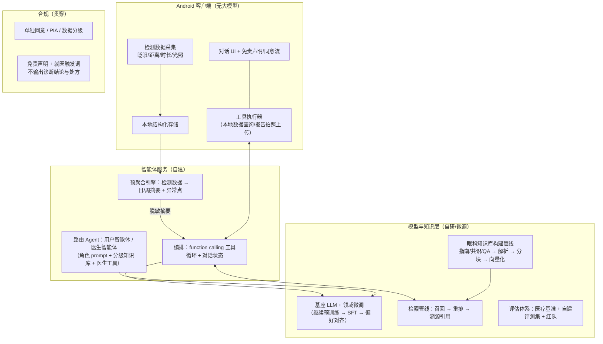

# 眼科智能体技术路线调研：自研/微调的实现方法与技术栈

- 日期：2026-09-11 | 方式：四路并行检索代理（端侧运行 / 医疗对话与 RAG / Agent 编排与对标 / 报告分析与合规）+ 微调与推理服务栈补查
- 背景：EyeProject（Android 眼健康 app）计划内嵌**眼科智能体**，对标蚂蚁「阿福」（原 AQ）。四条需求：①对话大模型懂眼科知识；②分析眼科检测报告；③分析手机上的实时检测数据；④眼科医生专有智能体
- **边界（按需求方约定）**：模型与 RAG 均为**自行构建或微调**——本报告不指定具体模型选型，只给**可行的技术路线、实现方法与基础设施技术栈**；基座仅列选型维度。已确认**不做端侧大模型**（客户端只承担采集与工具执行）
- 关联：眨眼检测路线实验见 [standalone-blink-experiment-report.md](standalone-blink-experiment-report.md)

---

## 1. 需求拆解 → 技术组件映射

| # | 需求 | 技术组件（自研/微调范围） | 成熟度 |
|---|---|---|---|
| ① | 对话大模型懂眼科知识 | 基座微调（CPT→SFT→偏好对齐）+ **RAG 管线**（知识库构建→检索→重排→溯源）+ 评估体系 | ✅ 方法成熟，有实证数据 |
| ② | 分析眼科检测报告 | 报告 OCR/解析 → 结构化确认 → **上下文注入**；验光单语义换算微调先例 | ⚠️ 需上下文工程（纯图像很弱） |
| ③ | 分析实时检测数据 | Function calling 数据查询工具 + **预聚合摘要**注入（LLM 直读时序已证伪） | ✅ 高（PHIA 模式） |
| ④ | 眼科医生专有智能体 | **双 Agent 路由** + 角色化 sub-agent + 分级知识库（公开学术架构可参照） | ✅ 中 |
| — | 支撑 | 推理服务栈（vLLM/SGLang 类）+ 微调框架（LLaMA-Factory/Unsloth 类）+ 评估与红队 | ✅ 成熟 |

---

## 2. 总体架构



**职责边界**：客户端只做采集、工具执行与对话 UI（不做端侧大模型）；智能体服务做编排与路由；模型与知识层为自研资产（微调模型 + 知识库 + 评估集）。

---

## 3. 模型层：自研/微调路线

### 3.1 基座选型标准（只列维度，不下结论）

| 维度 | 要点 |
|---|---|
| 许可 | 可商用、允许微调产物再分发（Apache-2.0 类 vs 附加条款） |
| 中文医疗能力 | 中文考试基准（CMExam/CMB）与中文眼科基准（**OphthBench**，591 题 9 任务）成绩；基准实测：通用大模型在眼科基准上**反超**医疗专用小模型 |
| 参数规模 | 服务端部署的显存/吞吐预算 vs 能力（7B/14B/32B/70B 档位） |
| 可微调性 | 全量/LoRA 生态支持、长上下文、多模态扩展性 |
| 生态 | tokenizer 对中文医疗词表友好度、推理框架兼容 |

（基座候选类别：开源可商用的通用中英双语基座系列，具体选择由团队按上述维度与实测评估确定。）

### 3.2 现成医疗模型为何不直接采用（论据）

2023 系中文医疗模型（HuatuGPT 系列/BenTsao/BianCang/DISC-MedLLM/CareGPT/Zhongjing/ShizhenGPT）普遍「代码开源但学术限定 + 停更 + 无 LICENSE 文件 + 无眼科特化」；眼科专用开源模型（OphGLM、EyecareGPT、OphVLM-R1）均为研究型、无商用授权。且 OphthBench 实测通用大模型反超医疗专用小模型 → **自建微调路线成立**。

### 3.3 微调方法与数据构建

| 阶段 | 方法 | 数据来源 |
|---|---|---|
| 领域继续预训练（CPT，可选） | 眼科教材/指南全文语料 | 近视防治指南 2024（卫健委 PDF）、干眼共识 2024、AAO BCSC（英文权威）、眼科教材 |
| SFT | 指令微调（问答/报告解读/工具调用三类任务混合） | Huatuo-26M（2600 万中文医疗 QA，Apache-2.0）筛眼科子集 + 自建眼科 QA + 真实问诊脱敏语料 |
| 偏好对齐（DPO/GRPO，可选） | 拒答/就医引导偏好 | 自建偏好对（安全回答 vs 幻觉回答） |
| **微调框架** | **LLaMA-Factory**（Apache-2.0，WebUI，100+ 模型，SFT/DPO/GRPO，DeepSpeed/FSDP2 分布式）或 **Unsloth**（Apache-2.0，单卡 QLoRA 提速 ~2×、显存 -70%）；二者可组合（LLaMA-Factory 可挂 Unsloth 后端） | — |

**数据构建要点**：指南/共识 → QA 对的自动生成 + 专家抽检；自建评测集必须独立于训练集；**微调必须加入几何/位移增强类难例**（本项目眨眼实验实证：模型对构图分布极敏感）。

### 3.4 评估体系

- 公开基准：OphthBench（中文眼科）、CMExam、CMB（医疗中文综合）
- 自建评测：眼健康 FAQ 集 + 报告解读集 + 安全红线集（该拒答/该引导就医的边界样本）
- 红队：幻觉率、越权诊断尝试、诱导输出处方的对抗测试

---

## 4. 知识与 RAG 层：构建管线与实证

### 管线（每步都有成熟方法）

```
指南/共识/教材 PDF/药品说明书
  → 解析（版面分析 + 表格还原）
  → 分块（语义分块，保留条款编号——溯源引用的锚点）
  → 向量化（embedding 选型维度：中文医疗检索基准（MedicalRetrieval/CMedTEB）成绩、
     长文本支持、许可、维度/存储成本；多路向量+dense/sparse 混合检索）
  → 库（向量库选型维度：规模、过滤需求、端/云部署形态）
  → 查询管线：混合召回 → 重排（提升top精度）→ 溯源引用（条款级出处）→ 生成
```

### 实证数据（证明这条管线的必要性）

| 证据 | 数字 | 来源 |
|---|---|---|
| 医疗 RAG（MedRAG/MIRAGE，PubMed+BM25） | 弱模型 **+19~23%** 提升至 GPT-4 水平 | arXiv:2402.13178 |
| 眼科 RAG（BCSC 教材向量化 + 重排） | 开源模型 **+17~24%**；量化不损精度 | medRxiv 2024.11.18.24317510 |
| EyeRAG（指南知识图谱 + GraphRAG） | 幻觉率 **30% → 3.3%** | npj Digit Med 2026 |
| 医疗向量检索基准 | CMedTEB / MedicalRetrieval | arXiv:2604.10937 |

### 评测

忠实度/幻觉率（RAGAS 类自动指标）+ 引用正确率 + 眼科专家抽检；上线前红队（诱导输出诊断结论的对抗测试）。

---

## 5. Agent 编排层

### 5.1 双 Agent 路由与「多医生智能体」架构（需求④）

- **用户智能体**：健康科普 + 自有检测数据解读（趋势/参考措辞）+ 就医引导
- **医生智能体**：专业术语与临床指南全文检索（分级知识库）、患者数据汇总报告生成、随访建议草稿——**定位为医生的辅助工具**（监管细则：AI 不得替代医师接诊）

**「很多个医生智能体」的正确解法 = 单基座 + 医生配置层，而非多模型/多 Agent 实例**（蚂蚁阿福医生版已规模化验证：30 万实名医生、1000+ 医生 AI 分身）：

```
一个微调基座（全平台共享）
  + 医生配置层（DB，每医生一行）：
      persona（简介/擅长/问诊风格/形象音频）
      个人知识库（上传的科普文章/问答/诊疗经验 → RAG namespace 隔离）
      工具权限（预问诊/随访自动化/患者管理）
  + 质量机制：AI 先答 → 医生复核（doctor-in-the-loop，官方称一致率 90%+，已扩 16 科室）
```

- 运行时：患者会话定位医生 → 注入 persona + 检索该医生知识库 → 生成——**30 万医生 = 30 万行配置，不是一个模型**
- 规模化实证：段涛医生把十余年科普内容喂给分身，6 个月答 70 万问（本人日接诊仅 ~20 人）；技术门槛「上传照片+音频+知识库即可」
- 科室维度（少量固定，如屈光/青光眼/眼底亚专科）才用 SOLVE-Med 式「Router→专科 sub-agent→汇总」或 MedChat 的角色化面板；**医生个人维度用配置化**，两维度正交可叠加
- 来源：[阿福医生版上线](https://www.ithome.com/0/988/706.htm)、[30 万医生/1 亿用户](http://cn-witmed.com/list/13/21507.html)、[段涛案例](https://www.inewsweek.cn/society/2026-03-17/29342.shtml)、[doctor-in-the-loop](http://news.qq.com/rain/a/20260814A09X5800)
- 路由实现：登录态/角色切换即可；学术架构 SOLVE-Med（Router→专科 sub-agent，arXiv:2511.03391）与 MedChat（眼底分割+角色化面板，最贴眼科）作为**科室维度**的参考

### 5.2 工具调用循环

- 云端：function calling 工具集——`query_blink_data(date_range)`、`query_distance_stats()`、`get_screen_time()`、`summarize_report(report_id)` 等；工具返回**预聚合摘要**而非原始时序
- Android 端：工具执行器（本地数据查询 + 报告拍照上传）；对话 UI + 同意/免责流
- 编排选型：Google **ADK Kotlin**（官方 Android agent 框架：LlmAgent + tools + 协程流式）或自研 Kotlin 协程工具循环（成本可控，无框架锁定）

---

## 6. 数据接入层

### 6.1 实时检测数据（需求③）

LLM 直读原始时序数值推理弱（PHIA 论文结论），采用 **PHIA 模式**：预聚合引擎产出日/周摘要（均值/趋势/异常点/达标率）注入 prompt；复杂分析走 agent 生成查询代码执行。我们 app 的四类数据（眨眼/距离/时长/光照）都适合按日聚合。

### 6.2 检测报告（需求②）

多模态 LLM 纯读报告图很弱（GMAI-MMBench 最强模型 53.96%；GPT-4V 眼科实测纯图像 47.5% → 加临床上下文 67.5%）。路线：

1. 报告照片 → OCR/版面分析 → 结构化字段抽取（字段体系参照 OcularGuard schema：视力/球镜柱镜轴位/眼压 10-21mmHg/眼底描述；OCT 数值读取有 99.67% 准确率开源先例）
2. **用户确认结构化结果**（防止抽取错误流入下游）
3. 结构化 JSON + 患者上下文（年龄/性别）注入 LLM 解读
4. 验光单语义换算（「约500度→-5.00DS」）有 Qwen LoRA 微调先例（~1500 条标注）

---

## 7. 推理服务栈（自建部署）

| 引擎 | 特性 | 适用 |
|---|---|---|
| **vLLM** | PagedAttention + continuous batching，高吞吐、生态最成熟稳定 | 批量 API 服务、高并发 |
| **SGLang** | RadixAttention 前缀缓存 + 结构化调度，多轮对话/工具调用/Agent 控制流延迟更低；FP8 吞吐 +30~50% | **交互式对话 + Agent 场景（我们的主场景）** |
| LMDeploy / TensorRT-LLM / TGI | 各有侧重（显存最低/生产优化等） | 备选 |

- 实测参考（Qwen2.5-7B，A100）：SGLang TTFT 156ms / 312 tok/s，vLLM 182ms / 285 tok/s；4×L4 多场景 SGLang 全胜 5-15%
- 微调产物可无缝衔接：LLaMA-Factory/Unsloth 导出 → SGLang `launch_server`（OpenAI 兼容 API）
- 部署：K8s 均有成熟方案（vLLM Deployment + Device Plugin；SGLang StatefulSet/LeaderWorkerSet）
- 量化：FP8/INT8 服务端量化（吞吐 +30~50%、显存 -50%），上线前精度回归

---

## 8. 合规红线（贯穿所有阶段）

| 法规/文件 | 要点 | 落点 |
|---|---|---|
| PIPL 第 28/29/30/55 条 | 医疗健康=敏感个人信息；单独同意；增强告知；事前 PIA | 采集/上云前单独同意流 + PIA |
| 网络数据安全管理条例（2025-01-01） | 敏感个人信息处理要求 | 数据分级与最小化 |
| 生成式 AI 暂行办法第 17 条 | 面向公众的生成式服务需备案 | 自建服务上线前完成备案流程 |
| NMPA《AI 医用软件分类界定指导原则》 | 输出病变性质判定/诊疗建议 = 三类证；仅测量/展示/趋势参考 = 二类甚至非器械；尚无医用大模型获证 | **措辞定位「健康参考/趋势解读」，绝不输出病变判定与诊断结论** |
| 互联网诊疗监管细则第 13 条 | 严禁 AI 自动生成处方、AI 不得替代医师接诊 | 医生智能体 = 辅助工具 |
| 国卫办规划发〔2025〕30 号 | 「赋能而不替代」 | 同上 |
| 信通院《端侧大模型数据治理报告》 | 端侧部署不豁免厂商责任；数据上云回归管辖 | 本地优先；上云部分走同意+备案 |

**幻觉风险实证**：Stanford 基准直接采纳 AI 建议致严重危害占 24.6%；Winters v. OpenAI 诉讼（2025）；国内首例 AI 幻觉侵权案宣判（2026-01）。缓解 = RAG 溯源引用 + 就医触发词 + 免责声明（必要不充分，需持续红队）。

---

## 9. 落地路线（自研/微调视角）

| 阶段 | 内容 | 关键产出 |
|---|---|---|
| **M0 数据与知识库** | 眼科指南/共识/教材 → 解析入库；自建评测集（FAQ/报告解读/安全红线三集）；训练数据构建（公开 QA 筛选 + 指南转 QA + 专家抽检） | 知识库 v1 + 评测集 v1 |
| **M1 基座微调** | 基座按 §3.1 维度选定 → LLaMA-Factory/Unsloth SFT（+DPO）→ OphthBench/自建集评估迭代 | 领域微调模型 v1 |
| **M2 服务与 Agent** | SGLang/vLLM 部署 + RAG 检索管线 + 工具调用循环 + 双 Agent 路由 + Android 端集成 | 眼科智能体 MVP（对话+数据解读） |
| **M3 报告解读** | 报告 OCR/抽取 + 确认流 + 上下文注入解读（措辞合规） | 报告分析功能 |
| **M4 医生智能体** | 医生知识库分级 + 患者数据汇总工具 + 医生工作流集成 | 医生端功能 |
| 持续 | 评估迭代 + 红队 + 知识库运营 | — |

---

## 10. 风险与限制

1. **合规是硬约束**：措辞越界即触发三类证；医生智能体不得替代接诊——界面文案需法务复核
2. **幻觉致害已有判例**（Stanford 24.6%、国内首例宣判）——溯源+触发词+红队是持续运营项
3. **自建路线的隐性成本在数据不在模型**：知识库运营、标注、评测集维护是长期投入；微调只解决模型侧
4. **OCEC 构图共生教训的迁移**：本 app 眨眼实验实证「模型对输入构图分布极敏感」——智能体的微调数据必须覆盖真实分布（位移/裁剪/口语化），评估集必须独立
5. 调研未实测目标 GPU 的推理吞吐与微调显存——M1/M2 启动前需按选定基座做一次基准
6. 蚂蚁阿福编排架构无公开细节，产品形态可对标、技术不可照抄

## 11. 主要来源

- 模型层：[OphthBench](https://arxiv.org/abs/2502.01243)、[CMExam](https://arxiv.org/abs/2306.03030)、[CMB 榜单](https://cmedbenchmark.llmzoo.com/static/leaderboard.html)、[Huatuo-26M](https://github.com/FreedomIntelligence/Huatuo-26M)、[OphGLM](https://github.com/ML-AILab/OphGLM)、[EyecareGPT](https://github.com/ZJU4HealthCare/EyecareGPT)、各医疗模型仓库（正文已链）
- RAG 层：[MedRAG/MIRAGE](https://arxiv.org/abs/2402.13178)、[眼科 RAG 实证](https://www.medrxiv.org/content/10.1101/2024.11.18.24317510v2.full.pdf)、[EyeRAG](https://www.nature.com/articles/s41746-026-02860-7_reference.pdf)、[MedicalRetrieval/CMedTEB](https://arxiv.org/html/2604.10937v1)、[近视防治指南 2024](https://www.medlinks.cn/static/upload/file/20240601/1717216647168857.pdf)、[干眼共识 2024](https://rs.yiigle.com/cmaid/1523274)
- 编排/对标：[蚂蚁 AQ 发布](https://www.antgroup.com/news-media/press-releases/1750924800000)、[改名阿福](https://www.antgroup.com/news-media/press-releases/1765785600000)、[Google ADK Kotlin](https://developer.android.google.cn/ai/adk)、[llama.kt](https://github.com/jaswanthsanjay88/llama.kt)、[SOLVE-Med](https://arxiv.org/abs/2511.03391)、[MedChat](https://arxiv.org/html/2506.07400v2)、[Samsung Health Assistant](https://news.samsung.com/us/samsung-launches-health-assistant-beta-first-fully-integrated-ai-powered-assistant/)、[PHIA](https://www.nature.com/articles/s41467-025-67922-y)
- 报告/合规：[GMAI-MMBench](https://uni-medical.github.io/GMAI-MMBench.github.io/)、[GPT-4V 眼科实测](https://pmc.ncbi.nlm.nih.gov/articles/PMC11811221/)、[SNUBH_CharReadOCT](https://pmc.ncbi.nlm.nih.gov/articles/PMC7789748/)、[OcularGuard schema](https://github.com/kamongi/OcularGuard/blob/main/docs/CLINICAL_WORKFLOW_AND_DATASETS.md)、[验光单 LoRA 实践](https://blog.csdn.net/weixin_36474001/article/details/155870273)、[Airdoc 三类证](https://www.nmpa.gov.cn/zhuanti/cxylqx/cxylqxlm/20200810093435157.html)、[NMPA 分类界定原则](https://po-files.ks3-cn-beijing.ksyun.com/5f445d6af346fb3c83c3de37_f7fdb7445a64.pdf)、[互联网诊疗监管细则](https://www.gov.cn/zhengce/2022-06/20/content_5696821.htm)、[「人工智能+医疗卫生」实施意见](https://www.gov.cn/zhengce/zhengceku/202511/content_7047018.htm)、[端侧大模型数据治理报告](http://www.caict.ac.cn/kxyj/qwfb/ztbg/202602/P020260204608131542915.pdf)、[PIPL 全文](http://www.npc.gov.cn/npc/c2/c30834/202108/t20210820_313088.html)
- 微调/推理栈：[LLaMA-Factory](https://arxiv.org/pdf/2403.13372v3)、[Unsloth vs Axolotl vs TRL vs LLaMA-Factory 对比](https://aifuturefront.com/unsloth-vs-axolotl-vs-trl-vs-llama-factory-a-fine-tuning-framework-comparison-on-speed-vram-and-multi-gpu/)、[LLM 推理引擎基准](https://github.com/everythinggenai1/Inference-Engines/blob/main/README.md)、[SGLang vs vLLM](https://deploybase.ai/articles/sglang-vs-vllm)、[vLLM vs SGLang H100 实测](https://rawlinson.ca/articles/vllm-vs-sglang-performance-benchmark-h100)、[Unsloth SGLang 部署指南](https://docs.unsloth.ai/basics/inference-and-deployment/sglang-guide)

*AI 辅助说明：本调研由 Claude Code 四路并行检索代理完成，关键数字均溯源至官方文档/论文/法规原文；按需求方约定，报告不含具体模型选型结论，基座/RAG/训练为自行构建与微调。*
