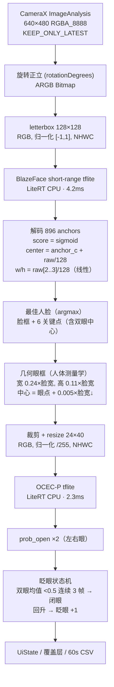
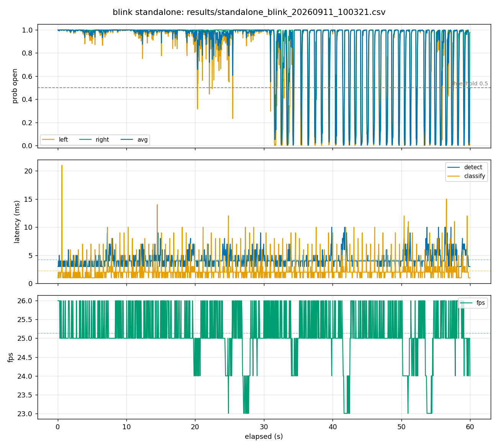
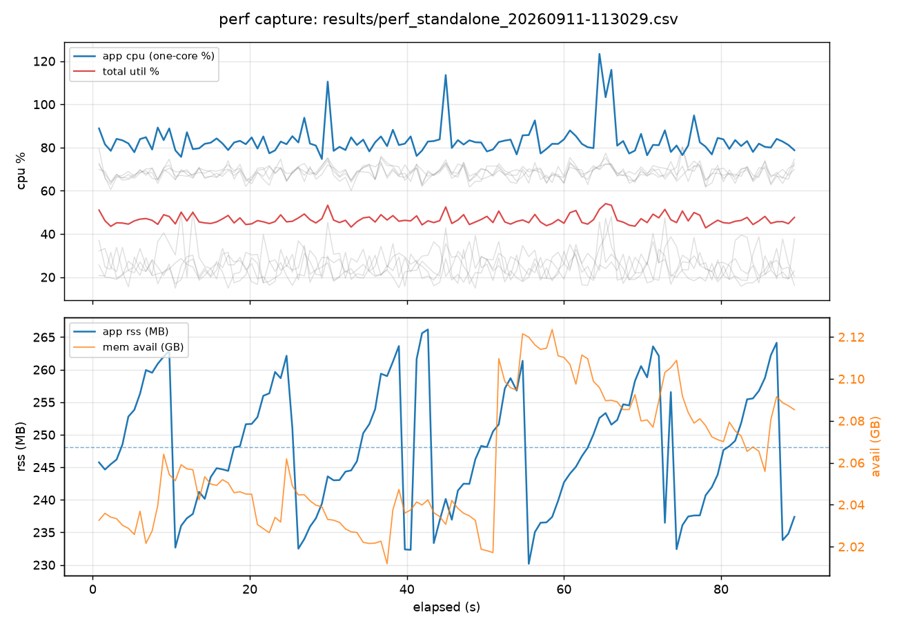

# 全替换眨眼检测路线（BlazeFace+OCEC）实验报告

- 日期：2026-09-11 | 设备：OnePlus 系真机（AN5H6R3826001803，8 核，前置相机 640×480）
- 实验：在 Android 端**完全去除 MediaPipe**，用「BlazeFace 人脸检测 + OCEC-P 睁闭眼分类」实现眨眼检测，并与 OCEC 原论文路线（DEIMv2+OCEC）及现有 MediaPipe 路线（blink 页）对比
- 配套调研：`ocec-standalone-pipeline-research.md`（模型选型与解码验证）、`on-device-landmark-models-3w-scan.md`、`on-device-face-eye-blink-models-lit-review-2026.md`

---

## 1. 结论摘要

| 维度 | 结果 |
|---|---|
| 可行性 | ✅ 管线在真机实时运行：**fps 25.1（23-26），检测 4.2ms + 分类 2.3ms ≈ 6.5ms/帧**（MediaPipe 路线为 27.5ms，提速 ~4×） |
| 精度（数据集） | BlazeFace+OCEC **F1 0.9873**；DEIMv2+OCEC **F1 0.9975**；GT 框上限 0.9938 |
| 精度（真机 60s） | 睁眼 30s：**误判帧 0%、假眨眼 0 次**；连续眨眼 30s：计数 31 次、零假阳性 |
| 模型体积 | **345KB**（BlazeFace 229KB + OCEC-P 115KB），对比 MediaPipe `.task` 3.76MB |
| 系统负载 | 应用 CPU 折算单核 **83.3% vs MediaPipe 路线 195.3%**（perf-capture 实测，↓57%）；帧率 25.1 vs 20.7 |
| 关键教训 | 裁剪构图必须匹配训练分布（零 margin 紧框）；几何参数按人体测量学标定 |

---

## 2. 最终路线数据流图

**易错点备忘**（实现时踩过/核对过的）：两个模型归一化不同（[-1,1] vs /255）；tflite 为 NHWC；输出 ByteBuffer 每次 run 前必须 `clear()`（position 不复位会 `BufferOverflowException`）；相机 RGBA → `getPixels()` 的 ARGB int 中 R 在 bit16-23（前置镜像在覆盖层做 `x → width-x`）。

### 参与对比的模型介绍

| 模型 | 出处 / 架构 | 规格 | 许可 | 本实验角色 |
|---|---|---|---|---|
| **BlazeFace short-range** | Google 2019（[arXiv:1907.05047](https://arxiv.org/abs/1907.05047)），MediaPipe 全部人脸管线的第一级 | SSD 式单发检测器，输入 128×128，输出脸框 + 6 关键点（双眼/鼻/嘴/双耳廓）；tflite 229KB；Mobile GPU 3.6ms（Pixel 9 Pro） | Apache-2.0 | 人脸定位 + 眼点粗定位（最终路线） |
| **OCEC-P** | [PINTO0309/OCEC](https://github.com/PINTO0309/OCEC)，2025-10（Katsuya Hyodo） | 极简深度可分离 CNN（baseline / inverted_se / convnext 三种骨干可选），输入 24×40 眼片，二分类 prob_open；六变体 112KB-6.4MB，F1 0.9924-0.9954 | MIT | 睁闭眼分类（最终路线） |
| **DEIMv2-Wholebody34** | [Intellindust-AI-Lab/DEIMv2](https://github.com/Intellindust-AI-Lab/DEIMv2)（"Real-Time Object Detection Meets DINOv3"）+ [PINTO0309 移植](https://github.com/PINTO0309/PINTO_model_zoo/tree/main/472_DEIMv2-Wholebody34) | RT-DETR 系 query-based 检测（无 NMS），34 类人体部位一次检出；DINOv3 ViT 骨干（S 40MB/X 203MB）与 HGNetV2 轻量骨干；训练 = COCO-Hand + CD-COCO 扰动增强 + 作者自标 103 万条 | 见仓库 | 原论文路线的眼框检测器（对照）；**OCEC 训练裁剪的来源** |
| **SegFace-MobileNetV3** | [Kartik-3004/SegFace](https://github.com/Kartik-3004/SegFace)，AAAI 2025 | SAM 式 mask-decoder 人脸解析，19 类（含左右眼/眉/眼镜），CelebAMask-HQ F1 87.91（MobileNetV3 版）/ 89.22（大版）；512×512 输入 | MIT | 分割路线对照；候选离线标注器 |
| 数据集 `closed-open-eyes` | [HF: MichalMlodawski](https://huggingface.co/datasets/MichalMlodawski/closed-open-eyes)，2024-07 | ~12.7 万张 512×512 + 左右眼 GT 框 + 开闭标签 | ODC-By v1.0 | 评估基准；**OCEC 训练数据源** |

---

## 3. 数据集精度对比（deliverable 1）

### 数据集与测试量

- **数据集**：`MichalMlodawski/closed-open-eyes`（HuggingFace，ODC-By v1.0 许可）——**OCEC 的训练数据源**。
- **结构与规模**：1266 个 parquet 分片 × 100 行 ≈ **126,600 张** 512×512 JPEG；每行含左右眼 GT 框（`Left/Right_eye_react`，[x,y,w,h]）、标签（`closed_eyes`/`open_eyes`）与原图。分片按标签聚合（相邻分片同标签）。
- **本次抽样**：4 个分片共 **400 张图**（closed 200 + open 200；分片 001/002 为 closed、900/1200 为 open）——所有管线对比在同一批图上进行。
- **各实验测试量**：GT 框上限评估 = **800 个 GT 眼片**；四条检测管线图像级对比 = **400 图**；真机 60s 检测 = **1480 帧**（睁眼 741 + 眨眼 739）。
- 评估口径：图像级（双眼概率均值 ≥0.5 判睁眼）；PC CPU（onnxruntime，Python 前后处理）。

### 对比结果

| 管线 | 检出率 | Accuracy | Precision | Recall | F1 | PC 耗时/图 |
|---|---|---|---|---|---|---|
| GT 框 + OCEC（上限参考） | 800/800 眼 | 99.38% | 0.990 | 0.998 | **0.9938** | ~0.2ms |
| **DEIMv2-S + OCEC**（原论文路线） | 400/400 | **99.75%** | 1.000 | 0.995 | **0.9975** | **626ms** |
| **BlazeFace + 几何裁剪 + OCEC**（本路线） | 400/400 | 98.75% | 1.000 | 0.975 | **0.9873** | **2.8ms** |
| SegFace-MobileNetV3 + OCEC | 400/400 | 79.21% | 0.979 | 0.801 | 0.8810 | 499ms |

\* SegFace 行：眼类 mask 与 GT 眼框的 **IoU mean 仅 0.128（p25=0.000，四分之一样本零重叠）**——分割框位置与 GT 标注约定严重不对齐，导致 OCEC 收到大量非眼构图裁片（recall 0.80）。原始统计见 `results/dataset_eval/segface_dataset_eval.txt`，构图共生分析见 §5。

- 两条管线全部 400 图检出人脸/眼部（检出率 100%）
- DEIMv2 检测框更贴训练分布（其本身就是训练时的裁剪来源），F1 略高 1 个点
- 本路线 recall 0.975：少量睁眼图被几何裁剪框切偏后误判为闭——与真机几何敏感性一致
- **速度差 224×**（626ms vs 2.8ms，PC CPU；均为 Python 前后处理口径）

---

## 4. 真机 60 秒检测（deliverable 2）

协议：前 30s 保持睁眼，后 30s 连续眨眼。当前版本（人体测量学眼框）。

| 指标 | 睁眼段 (0-30s) | 眨眼段 (30-60s) |
|---|---|---|
| prob_avg mean | **0.981** | 0.776 |
| 误判帧（<0.5） | **0.0%**（0/741） | 22.5%（连续眨眼时的闭眼帧，属正常） |
| 假眨眼（3 帧滤波） | **0 次** | — |
| 眨眼计数 | — | **31**（连续眨眼节奏 ~1Hz，零假阳性） |

**几何参数迭代全过程**（眼框裁剪是本实验最大的坑）：

| 版本 | 眼框定义 | 睁眼段误判帧 | 假眨眼/30s |
|---|---|---|---|
| v1 宽松 | 脸宽×0.32 + 25% margin（含眉毛/镜框/皮肤） | 13.9% | 8 次 |
| v2 过紧 | 脸宽×0.18（几何扫描过拟合产物） | 9.4% | 6 次 |
| **v3 人体测量学** | **睑裂宽 0.21×面宽 + 15% 余量 = 0.24；睑裂高 1/3 裂宽；中心=瞳孔** | **0.0%** | **0 次** |

根因：OCEC 训练眼片是**检测框零 margin 直切**（`03_wholebody34_data_extractor.py` 的 `crop_eye_region`，眼睛占满画幅，无旋转/尺度增强）——宽松框与训练构图分布完全不同。v3 的 0.24 宽在「覆盖全睑裂」（物理正确）与「贴近训练构图」之间取得平衡。

**性能对比（同设备）**：

| 指标 | MediaPipe 路线（blink 页） | 本路线（standalone 页） |
|---|---|---|
| 帧率 | 20.7 fps（min 13） | **25.1 fps（min 23）** |
| 检测+推理 | mean 27.5ms（p95 44） | **det 4.2ms + cls 2.3ms**（p95 7/7） |
| 模型体积 | 3.76MB（.task） | **345KB** |
| 依赖 | MediaPipe tasks-vision 1.0.0 | 仅 LiteRT |

### 系统级资源占用（perf-capture 实测，deliverable 2 补充）

perf-capture 60 秒采样（120 行 @0.5s，页面操作中采集）：

| 系统级指标 | MediaPipe 路线（blink 页，09-10 采集） | **本路线（standalone 页，本次采集）** |
|---|---|---|
| app_cpu_one_core_pct | mean **195.3**（148-236） | **mean 83.3**（75-123），↓57% |
| app_cpu_of_total_pct | mean 25.0（占全机 1/4） | **10.6** |
| total_cpu_util_pct | 64.5 | 46.7 |
| threads | 77 | 58 |
| rss_mb | 176.3（锯齿 162-195） | 248.1（锯齿 230-266） |
| hwm_mb | 366.9 | 339.3 |
| 应用内帧率 | 20.7 fps | **25.1 fps** |

- **CPU 占用减半以上**：应用折算单核从 195% 降到 83%——LiteRT CPU 推理负载平稳（曲线无尖峰），对照图里 MediaPipe 时代偶发 110-131ms 的推理尖刺在本路线延迟面板中仅存预热期一次
- 采样产物：`results/data/perf/perf_standalone_20260911-113029.csv` + `results/charts/perf_standalone_20260911-113029.png`；blink 页对照数据 `results/data/perf/perf_20260910-093045.csv` + `results/charts/perf_20260910-093045.png`
- 诚实备注：RSS 均值更高（248 vs 176MB）且仍有 ±18MB 分配锯齿——LiteRT 双 Interpreter 与逐帧位图转换的代价；锯齿非泄漏（无单调增长），后续可用与 blink 页相同的位图复用手段优化

---

## 5. 为什么不采用 OCEC 原论文路线（DEIMv2+OCEC）（deliverable 4）

原路线 = DEIMv2-Wholebody34（34 类人体部位检测器，直接检出 eye 框）+ OCEC。数据集上它确实更强（F1 0.9975 vs 0.9873，检出框与训练裁剪同源），但被以下事实否决：

1. **速度差 224 倍**：DEIMv2-S PC CPU 626ms/图 vs BlazeFace 管线 2.8ms/图。瓶颈是 1750 query 的 transformer 解码器——实测**与输入分辨率无关**（240×320 与 640×640 同级），无法靠降分辨率挽救；X 变体（DINOv3-X）单文件 203MB。
2. **移动端模型缺口**：轻量骨干（HGNetV2 Atto/Femto/Pico，权重 2.2-14.7MB）的 wholebody34 ONNX **未单独发布**（仅藏在 zoo 整包 tar 中，且 coco 版 pth 无 eye 类）——需要自行导出，转换链路（torch→onnx→tflite）未经验证。
3. **本路线的精度损失只有 1 个 F1 点**（0.9873 vs 0.9975，数据集口径），真机 60s 已达零误判零假阳性——用 224× 的速度换 1 个点不成立。

**保留路径**：若未来 zoo 发布 HGNetV2 wholebody34 的 ONNX/tflite（预期手机 CPU 数十 ms 级），可用其替换 BlazeFace 做对照实验——testmodel 页面结构已支持。

---

## 6. 已知限制与后续工作

1. **单用户验证**：本报告数据来自单一用户（戴眼镜）。几何参数（0.24/0.11/0.005）按人体测量学均值设计，但 OCEC 未在「该用户分布」上微调——换人后建议先用 60s 检测 + `analyze_standalone_blink_test.py` 快速体检。
2. **极端姿态**：头后仰 ~45° 时 BlazeFace 眼点会漂移（第二只眼滑到鼻梁，见 `results/figures/deimv2_vs_blaze_detection.png` 黄框）。微调时加入**随机平移/缩放增强**可显著缓解（OCEC 训练无几何增强，`RandomRotation` 被原作者注释）。
3. **微调计划**（数据采集协议已就绪，采样功能随录制自动存眼片到 `files/crops/`）：睁眼保持 / 闭眼保持 / 正常眨眼各一段 → 按时间轴打标 → OCEC 仓库训练管线微调 P 变体 → onnx2tf → 替换 assets → 同协议复测。训练集可混入 `closed-open-eyes` 数据集样本防遗忘。
4. **对比基线**：blink 页（MediaPipe+EAR）在同设备 27.5ms/20.7fps，其 EAR 阈值未做个性化校准（文献：固定 EAR 91.7% vs 个性化 93.2% vs CNN 99.1%）——两页可作长期 A/B。

## 7. 产物清单

| 文件 | 内容 |
|---|---|
| `results/standalone-blink-experiment-report.md` | 本报告 |
| `results/data/standalone60s/`（4 个 CSV）+ `results/charts/standalone_blink_20260911_100321.png` | 60s 检测数据（几何迭代全程）+ 三面板图（最终几何） |
| `results/data/perf/` + `results/charts/perf_*.png` | 两次 perf-capture 采样与 CPU/内存双面板图（MediaPipe 对照 + 本路线） |
| `results/data/blink60s/blink_test_20260910_090718.csv` | MediaPipe 路线（blink 页）60s 检测数据 |
| `results/data/crops/session1/`（50 张） | 设备眼片采样第一轮（宽松框、睁眼段） |
| `results/dataset_eval/` + `results/eval_scripts/` | 数据集三管线对比结果与全部评估脚本 |
| `results/charts/crops_montage.png`、`results/charts/blink_phase_crops.png` | 眼片蒙太奇（PC 复核 + 眨眼段） |
| `results/figures/anthro_eyebox_check.png`、`results/figures/deimv2_vs_blaze_detection.png`、`results/figures/deimv2_eye_crop.png` | 眼框设计验证图 |
| `results/charts/dataset_crops_montage.png` | 数据集眼片外观参照 |
| `feature/testmodel/tools/analyze_standalone_blink_test.py` | standalone CSV 分析脚本（可复用） |
| `feature/testmodel/src/main/java/.../standalone/` | Android 实现（6 文件 + assets 双模型） |

*AI 辅助说明：本实验的检索、脚本编写与数据分析由 Claude Code 多代理/工具链辅助完成，所有关键数字均经真机/PC 实测或原始文献核对。*
